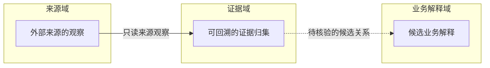

# Diagram-as-Code 可复制模板

先读 `../30_PROTOCOLS/DIAGRAM_AS_CODE.md`。下面就是样板；没有适用行就删掉，不留空壳。

## README 首屏放置

```text
# 项目名

1–3 句：它是什么 / 拥有什么 / 不拥有什么

[项目架构总览图 / 总图入口]

当前阶段 / 关键入口 / 下一跳

详细正文……
```

布局口诀：**总图放入口，细图贴对象；入口在 README，图源在附近。**

复杂度口诀：**规模不是删信息的理由；规模变大，优先增加层级、区域与下钻。**

- 根 README 只放项目级总图/入口；
- 图源默认放 `docs/diagrams/**` 或 semantic owner 对应子系统附近；
- 子系统自己的复杂图放其局部 README/目录，不抬到根 README；
- 不建立脱离 owner 的中央 diagrams 大杂烩或独立 shared 图纸仓。

## 静态架构 / ownership 图

```text
图：Portfolio / Project Architecture
类型：architecture
图源：docs/diagrams/architecture.json
入口：README.md 第一屏（1–3 句项目定位之后）
Authority：DERIVED
Canonical source：README / contracts / registry / exact architecture Issue
回答：谁拥有哪类 truth；主要 capability/data flow；相邻 owner 在哪
边语义：实线 = confirmed primary flow；虚线 = support/reuse candidate
验证：machine validate/render + Architect semantic review
```

适合：跨仓 topology、Project Architecture、ownership map。

## 动态项目状态图

```text
图：Portfolio Status
类型：architecture
图源：docs/diagrams/portfolio-status.json
入口：Portfolio / Project README 的导航区
Authority：DERIVED
Source：current repo README / CURRENT_STATE / latest accepted Issue/PR/report
Verified：2026-09-14
Freshness：LIVE_READ
状态压缩：ACTIVE | BLOCKED | STABLE | EXPERIMENTAL | HOLD | UNKNOWN
规则：无 current read 不继续称 current；无 source pointer 就 UNKNOWN；不生成伪精确百分比
```

适合：项目很多、Human/Architect 需要快速知道“发展到哪里 / 卡在哪里 / 下一 Gate”。

## Lifecycle / 状态机

```text
图：Managed Node Lifecycle
类型：lifecycle
图源：docs/diagrams/node-lifecycle.json
入口：拥有该 lifecycle 的子系统 README
Authority：DERIVED
Canonical source：contracts/FLEET.md
回答：合法状态、转换 gate、异常/退出路径
禁止：从图反向创造新 lifecycle state
```

## Sequence / 调用链

```text
图：Wake → Agent Host → Executor
类型：sequence
图源：docs/diagrams/wake-sequence.json
入口：对应 Execution Fabric / runtime 子系统 README
Authority：DERIVED
Canonical source：exact runtime contract + current implementation
回答：谁先调用谁；在哪一步验证 authority/currentness；失败在哪里返回
禁止：把时序图里的参与者自动解释成 ownership hierarchy
```

## Dataflow / Evidence pipeline

```text
图：Eye → Juece Evidence Flow
类型：dataflow
图源：docs/diagrams/evidence-flow.json
入口：producer/consumer contract 附近的 README / architecture index
Authority：DERIVED
Canonical source：producer/consumer contracts
回答：哪些 artifact/reference 穿过边界；谁保持 canonical truth；哪里发生 transformation
禁止：复制 producer raw truth 到 consumer 形成第二 SSOT
```

## 复杂图设计 / Review checklist

当一张图开始变复杂，不要先问“最多能画多少节点”，先判断是哪一种复杂：

```text
Render scale
- renderer/browser 是否有真实 benchmark / stress evidence？
- 没有 evidence 时，不声称已经验证 100 / 1000 nodes。

Default-view readability
- 默认桌面视图主要文字是否可读？
- 是否有 edge-through-node / crossing / shared corridor？
- label 是否压线、压节点或依赖频繁 zoom 才能读？

Semantic complexity
- 这张图是否同时回答多个层级的问题？
- 是否混合 architecture / workflow / delivery / implementation？
- Fresh Agent 能否直接判断 owner 与下一 source pointer？
```

优先修复顺序：

```text
1. 分清失败类别；
2. 不同阅读任务 -> 分层 / 独立 view；
3. 同层复杂 -> region / lane / subgraph；
4. 调 edge route / corridor / label placement；
5. 缩短节点 copy，把细节移到 inspector/card/pointer；
6. 必要时调画布/节点尺寸；
7. 只删重复 presentation，不删关键语义。
```

禁止默认使用：

```text
无限缩小字号
为了过 validator 删除关键 dependency / ownership
把不同 relation 合并成一条含糊线
让 Portfolio 总图复制 Project / Work / Delivery 全部细节
```

validator 结果解释：

```text
READABILITY_FAIL        != renderer capacity failure
ROUTING_FAIL            != renderer capacity failure
LABEL_CLEARANCE_FAIL    != renderer capacity failure
SEMANTIC_LAYERING_FAIL  = 应重新分层/分区
RENDER_CAPACITY_FAIL    = 只有真实性能/容量证据成立时才使用

showcase PASS
!= semantic correctness
!= Human visual acceptance
!= large-scale benchmark proof
```

## Progressive drill-down

```text
L0 Portfolio
  -> repo / owner / capability / major flow

L1 Project
  -> phase / canonical surfaces / adjacent owners

L2 Program / Work Graph
  -> Issue / dependency / gate / owner

L3 Delivery
  -> PR / exact head / checks / evidence

L4 Implementation
  -> file / module / class / function / interface
```

不要把层级理解成固定节点数限制。同层仍复杂时先按 `domain / region / lane / subgraph` 分区；阅读任务变化时再下钻。

## 阶段性架构复盘图示

当 Project/Global Architect 处于有实质性领域/依赖决策、跨模块进展或架构 handoff 的阶段，按 [Diagram-as-Code §3.1](../30_PROTOCOLS/DIAGRAM_AS_CODE.md#31-阶段性进展图示与领域边界复盘) 在原 Work / PR / checkpoint 中**新建、更新或复用**图示。不另开平行“进展状态库”，也不要求每次把相同的架构重画一遍。

### 可复制的阶段汇报

```text
阶段：<当前 Work 的有意义阶段>
工作坐标：<owner>/<repo>#<issue>@<lane>
diagram_action: CREATE | UPDATE | REUSE_CURRENT | NOT_APPLICABLE
diagram_type: architecture | dependency | dataflow | sequence | lifecycle | timeline
diagram_source: <owner 项目中可 Git diff 的 Mermaid / DOT / IR 指针，或当前可复用图源>
canonical_source: <owner contract / exact PR / Issue / code revision>
as_of: <核验时间 / revision 与窗口；不确定则 UNKNOWN>
authority: DERIVED
前阶段：<既有图源/状态指针，或无>
本阶段真实变化：<哪些边界、依赖、来源、实现或验证发生变化；证据指针>
尚未证实：<候选/不确定/失败的节点或边；不可写作已验收>
下一步：<依赖/门槛/有界动作 + 现行 owner>
```

**精简条件**：原图仍 current 且模块/责任/依赖没有变化，选 `REUSE_CURRENT`，用“现有图指针 + 变化/未变化说明”即可；纯窄修复用 `NOT_APPLICABLE` 并给理由。不能拿一个没有实际来源和 revision 的图冒充真实阶段进展。

### 适用于来源与业务解释分离的简单 Mermaid 示意



这是**架构边界示例**，不宣称任何具体系统已经实施。实线/虚线的含义要以图旁 legend 为准：可用实线表达已证实的主流程，虚线表达仍待核验/候选依赖。必须有来源指针支持；如果无法说明两个模块为什么分开、由谁持有状态，问题在工程设计而不在图形布局。

### 专门检查的失败反例

- **“代码已经分成四个文件”**：但四个文件彼此双向调用，共享可变全局状态；图应如实暴露双向边或环，不得改画成理想单向结构。
- **“图能成功渲染”**：实际没有 source pointer / verified_at，也没验证新代码；图仅证明文本/布局可呈现，不证明架构正确。
- **“本阶段完成 100%”**：只存在模型口头声明；应标 `UNKNOWN` 或对应实测状态，不凭好看的箭头提升验收等级。
- **“架构完全没变化”**：如果当前图的 source 和版本仍有证据支持，用 `REUSE_CURRENT`；不强迫复制另一份图或生成空泛百分比。

## PR / Issue 说明句

```text
本图为 DERIVED navigation/read model；canonical source 仍为 <pointer>。
图源可 Git diff；rendered HTML/SVG/PNG 为可重建 presentation artifact。
总图入口位于 <README pointer>；局部图跟随 semantic owner，不建立中央图纸 SSOT。
本次若图与 canonical source 冲突，以 canonical source 为准并修 diagram drift。
若 validator 拦截，本 PR 按 readability / routing / semantic layering / real capacity 分类别解释，不把版式失败误写成 renderer 节点规模上限。
```
