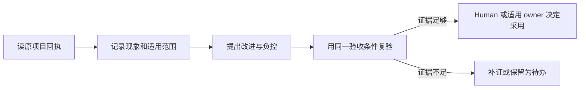

# 人机协作工艺

这里是 `ai-use` 人机协作工艺的 GitHub 入口。工艺观察者在获得授权的现场独立观察，记录人和 Agent 如何交接、用工具、纠错和恢复，再用可复验的小试验检验改进。Human 决定目标和采用范围。项目派工、施工、Review 与验收由各项目 owner 负责。 [建立入口的 Work](https://github.com/youling/ai-use/issues/199) · [目录归属的 ADR](../90_HISTORY/ADR-0027_AGENT_CRAFT_HOME.md)

[工艺待办](BACKLOG.md) · [专题研究](../docs/research/README.md) · [角色与权限](../20_ROLES/README.md) · [证据归属](../30_PROTOCOLS/OWNER_INSTANCE_BOUNDARY.md)

## 从一次观察到采用

项目事实引用原 owner 的 Issue、PR、精确提交或验收回执。专题研究引用 `docs/research/`。现场原件、账号及拓扑由相应实例保管。恢复时先读本页和待办，再沿 owner 指针回读最新证据与裁决。 [现场日志](../30_PROTOCOLS/LOCAL_WORKSITE_LOG.md) · [持久证据](../30_PROTOCOLS/DURABLE_TRACE_PRINCIPLE.md)

## 首轮观察与验证范围

| 主题 | 已观察或试行 | 可复用入口 |
| --- | --- | --- |
| 长任务分段与接力 | 在本机免费模型调研中，以可验收阶段产物和会话回执恢复。HTTP 请求结果、文本完成情况与上游用量各自核验。 | [可恢复执行专题](../docs/research/agent-governance-20261117/README.md) · [Agent Craft / DWF 研究草稿 #192](https://github.com/youling/ai-use/pull/192) |
| 压缩与交互体验 | 把上下文恢复后是否保留早期边界、接手人定位下一步的时间列为试验指标。插件与原生压缩的同任务对照待做。 | [上下文生命周期研究基线](../90_HISTORY/ADR-0002_CONTEXT_LIFECYCLE_V0_1.md) · [试验待办](BACKLOG.md#craft-002上下文压缩与交互对照) |
| 免费与低消耗发现 | 在本机核对了供应商目录、账号可见性和工头筛选条件。公开价目、套餐余量与实际用量分别读取。两节点的合成 Chat Completions 试验验证了远端调用和宿主侧 429 换路对账。 | [Magpie 接线研究基线](../docs/research/magpie-cli-bridge-20261112/README.md) · [零价候选待办](BACKLOG.md#craft-003免费与低消耗模型覆盖) |

本机观察记录按证据覆盖使用。可跨项目采用的做法由适用 owner 审查并写回对应规则或项目记录。 [变更生命周期](../30_PROTOCOLS/CHANGE_LIFECYCLE.md)
