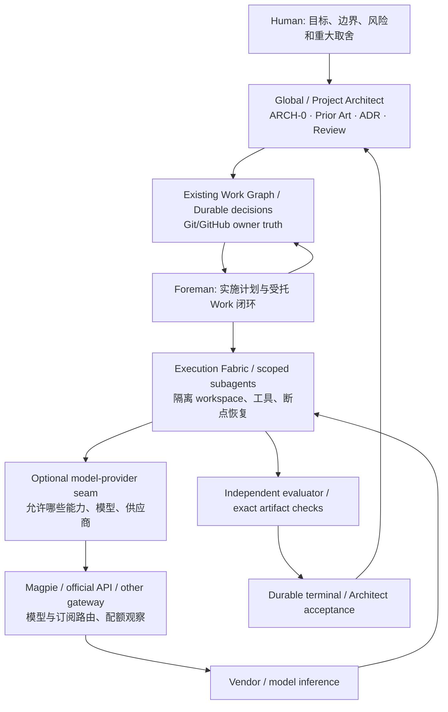

# AI 公司人机协作、长任务编排与模型订阅网关：2026-10-13 Architecture Discovery

**Classification: NON-NORMATIVE / L3 RESEARCH · as_of: 2026-10-13 (CST) · evidence: upstream documentation + public primary research, NOT LOCAL EXECUTION / NOT PRODUCTION QUALIFICATION**

**Human direction:** 研究最新 AI 公司如何组织 Human、Architect/agent、多步骤研究和工程执行，审查前沿数学研究对协作流程的启发，并重点评估 [yetone/magpie](https://github.com/yetone/magpie)。这是 **Architect-owned ARCH-0**，不是 Foreman 的无界工作。Rationale / accepted research scope: [ai-use #152](https://github.com/youling/ai-use/issues/152)。单一规范所有者仍是 [Architect Reconnaissance](../../ARCHITECT_RECONNAISSANCE.md)；本文不修改 L0、Role、Work lifecycle 或 provider 默认设置。

> **关键结论**：AI 工厂至少需要分别解决（1）Human/Architect 的目标与架构决策、（2）可恢复 Work 编排与权限、（3）运行时 Agent/工具调用、（4）模型/订阅路由、（5）独立证据验证。Magpie 主要解决第 4 层和部分工具配置同步，**不是** Work Graph、Architect、长期 Foreman 或 durable scheduler 的替代品。数学研究表明「高产候选」之后的「命题对应/独立核验」正在成为重要瓶颈。

## 1. 研究范围与证据纪律

样本横跨 OpenAI、Anthropic、Google DeepMind/ADK/A2A、Microsoft Agent Framework/Agent 365、Atlassian Rovo、Temporal，以及 Magpie/LiteLLM/CC Switch/New API 等开源组件。只针对用户提出的能力链做代表性、可判别的覆盖，不声称穷举全部互联网或掌握这些公司的非公开内部组织架构。

证据阶梯：`UPSTREAM_DOCUMENTED`（上游文档或供应商声明）/ `PUBLIC_RESEARCH`（公开论文/工程案例及自述条件）/ `INDEPENDENT_COMMENTARY`（外部评价，需独立核实）/ `LOCAL_REPRODUCED`（在指定我们的环境重新跑过）/ `UNKNOWN`。本轮 **无 LOCAL_REPRODUCED**：没有安装/调用 Magpie，没有传入任何 OAuth、API key、私有拓扑或订阅凭据。CI 若存在，只证明本文/仓库检查，不证明外部产品可用。逐条证据和 URL 见 [SOURCES.md](SOURCES.md)。

## 2. 各公司正在收敛的组织模式

| 研究对象 | 一手证据所显示的模式 | 真正可复用的机制 | 不可直接外推 |
| --- | --- | --- | --- |
| **OpenAI Codex App / Agents API** | 单一人类操作台监督多个独立 thread/任务；Agents API 提供独立上下文、子 agent 创建/消息/等待、中断与恢复；可用 MCP 工具和托管/自托管执行环境 | 「Human command center → 工作分解 → 独立上下文 → 结果综合」；把并行能力和授权分开 | API 的子 agent 即使有继承工具/共享文件系统的能力，也**不自动**获得 repo merge、递归委派或独立验证资格（[S01](SOURCES.md), [S02](SOURCES.md), [S03](SOURCES.md)） |
| **OpenAI dots** | 长期运行、云电脑、主动只读研究、用户可观察活动；Custom Rules 限定哪些操作可自主、需审批、禁止；部分敏感操作仍需本人完成 | 主动发现但只读、风险分层的动作审批、独立工作空间与活动可见性 | 产品宣传 ≠ 本实例的持续在线/订阅可用性/已具备所有执行权限（[S04](SOURCES.md)） |
| **OpenAI × Atlassian Rovo** | Teamwork Graph 将人、项目、文档、决策联接；Jira/Confluence 等原系统持有工作事实；AI 上层检索/汇总/建议 | 企业事实图 + canonical Work item + Agent 可导航 read model；与我们图的「蓝图 + 具体文档 pointer」方向吻合 | 不等于应再造全量知识图谱、也不让中央图取代项目 owner SSOT（[S05](SOURCES.md)） |
| **Anthropic Research** | lead agent 分拆独立搜索子 agent，按不同问题并行检索，汇总再决定是否扩大研究；案例披露协调效率及上下文隔离 | ARCH-0 由 Architect 定题/综合，子 research task 有范围/输出格式；按证据决定停与续 | 官方内部 benchmark/加速是特定任务结果；多 agent 不是所有问题都更优；同步子 agent 会造成等待瓶颈（[S06](SOURCES.md)） |
| **Anthropic 长任务工程 / C 编译器试验** | initializer/planner、增量交付、跨窗口 artifacts；generator/evaluator 反复验证；16 agents 编译器尝试有成本和有限终点 | 长任务靠「可恢复工件、拆分、独立判别、真实运行测试」而非单一会话永生；无需机械限定所有模型常驻深推理 | 这不是安全上推荐无约束权限或无限循环；案例总成本与场景不宜直接迁移（[S07](SOURCES.md), [S08](SOURCES.md), [S09](SOURCES.md)） |
| **Google ADK / A2A** | ADK 支持分工流水线，A2A 的 Agent Card / Task / Artifact 用于跨语言和跨进程协作，支持异步交付；MCP 是 Agent-to-tool 而非 Agent-to-Agent | 跨供应商适配、能力发现、任务上下文 pointer、长运行回执，避免二次封装每个 agent 内部细节 | A2A task state **不是我们 Work Graph SSOT**；A2A Task 必须映射到已有 attempt/work coordinate，而非成为第二控制平面（[S10](SOURCES.md), [S11](SOURCES.md)） |
| **Microsoft Agent Framework / Agent 365** | 顺序、并发、handoff、group chat、manager 动态编排；checkpoint 保留挂起的 Human 请求；Agent 365 把身份、登记、监控、政策分层 | 「角色/身份 ≠ 执行环境」；审批是可恢复的事件，执行规则随风险定；动态 manager 和确定性 workflow 并存 | Entra/Agent 365 是自有产品架构的参考实现，不意味着本仓需要增加审批层或租用微软平台（[S12](SOURCES.md), [S13](SOURCES.md)） |
| **Temporal/长运行工作流** | durable event history、retry/timeout、signals、人类批准后恢复；执行环境可丢弃，状态从 durable log 恢复 | 持久任务/临时 attempt、幂等外部动作、重试/信号/恢复的工程边界 | Git/GitHub 已可承载低频 Work；不因「有 Temporal」就先建另一套工作队列或 authoritative state（[S14](SOURCES.md)） |

**总体归纳（Architect inference）**：公司并未统一选择一个万能 multi-agent 框架。共性是逐步把 **Human 目标、可恢复工作状态、agent 会话、外部工具连接、结果验收** 分离；在某些路径采用动态分工，在高风险/长期等待路径引入确定性 checkpoint 和审批。用专业软件工程取代「一个 Agent + 一个巨型 prompt + 无限重试」。

## 3. 数学科研：更强的搜索力必须配更严格的验证链

### 3.1 观察事实

- Google DeepMind 2026-02 报告的 **Aletheia / Gemini Deep Think**：提出候选解 → 自然语言 verifier 检查错误 → 再生成/修订，并允许明示无法解决。官方报告若干 Erdős 开放问题、专家协同或自治研究成果，并**明确没有宣称其 Level 3/4 重大里程碑**（[S15](SOURCES.md)）。
- Google **AlphaEvolve** 将语言模型的代码搜索和外部 evaluator 结合，在有可计算目标的数学/算法问题上迭代筛选；官方 2025/2026 报告对某些公开数学问题取得改进。适用前提：存在可靠可执行评分器（[S16](SOURCES.md)）。
- OpenAI **First Proof** 2026-02 披露 10 项专业难题的证明尝试及专家反馈。OpenAI 曾认为某个证明可能正确，后来根据社区核查承认有误；官方也承认人工选择/提示、过程不完全受控（[S17](SOURCES.md)）。
- OpenAI 2026-08 披露 10 项数学/理论计算机科学研究主张及 Lean 形式化；2026-09 宣布 Navier–Stokes 证明并发布研究与 Lean；2026-10 又发布大规模数学结果及部分 Lean 形式化；公开材料正在接受社区质疑与审查。**供应商发布 ≠ 数学界已独立接受**，尤其需要区分「Lean 检查通过」与「formal statement 与原题语义等价」；不要把获奖级、已形式化、已被专家接纳混为一谈（[S18](SOURCES.md), [S19](SOURCES.md), [S20](SOURCES.md), [S21](SOURCES.md)）。

### 3.2 对人机协作的工程启示（不是新治理规则）

```text
Human/Architect: 研究命题、目标、有效贡献标准
  → Source/Problem registry: 原问题、前提、出处与已知结果
  → Bounded independent explorations: 多路线候选与交叉质疑
  → Candidate synthesis: 主张、推理、可验证 artifact
  → Counterexample search: 反例、反驳、负例、边界条件
  → Machine oracle: Lean / unit/integration tests / deterministic evaluation
  → Semantic correspondence check: 验证的命题/测试与原始要求是否一致
  → Independent expert / Architect acceptance
  → Durable publication: exact source + version + withdrawn/corrected status
```

**最重要的区分**：`GENERATED_CANDIDATE ≠ VERIFIED_PROOF ≠ HUMAN_ACCEPTED_DISCOVERY`，就像 `CHILD_SUCCESS ≠ WORK_CLOSED`。在软件工程中，相当于避免 Agent 为自己的方案编写弱化 acceptance 的测试再宣称 PASS；应保留原始需求/命题和独立 evaluator。

验证成本和结果消化能力可能成为新的瓶颈。对外部供应商研究宣称使用 `vendor claim / published proof / checked artifact / independent evaluation / unknown` 分级，且观察窗口随新证据更新。不能根据公开宣传推断内部模型向本地订阅开放。

## 4. Magpie：真实能力、重要缺口、入厂位置

本轮代码研究锚点为 `yetone/magpie@113672508a54da80b11523544b1bba75a4e02948`（2026-10-13 live GitHub main）；[README](https://github.com/yetone/magpie/blob/113672508a54da80b11523544b1bba75a4e02948/README.md) 与 [集成指南](https://github.com/yetone/magpie/blob/113672508a54da80b11523544b1bba75a4e02948/docs/integrating.md)。项目源仓 MIT 许可声明，更新很快；具体行为使用前重新 live-reconcile。

### 4.1 上游文档支持的能力（尚未本地复验）

1. 一个本机网关，默认 `127.0.0.1:3425`，提供 OpenAI Chat、Responses、Anthropic Messages、Gemini 等不同 API 协议的请求兼容/转换；支持流式、tools、reasoning 等，但 **「声明兼容」不保证对某个模型/feature 语义等价**。
2. 将模型来源、授权 API key、部分可登录的 AI 订阅和本地模型统一为 `provider/model`；按订阅窗口与模型路由组选择账号、按错误/额度切换，含黏性会话缓存与路由结果观察。提供 Usage、cost（按标价估算）、quota、request log。
3. 支持 CLI/TUI/桌面/网页，agent 配置适配器、Profiles，以及 MCP/skills/instructions 库同步；`magpie plugin` 可运行 OpenCode auth/PI provider 插件与 JS middleware（Bun runtime）。
4. 文档化 `GET /api/hello`、`GET /v1/models`、请求 endpoint、`X-Magpie-Session`、route、quotas/usage 接口，适合薄的 model-provider adapter；仅需要网关接入无需改动 Magpie 本身。
5. **不是** A2A agent registry、Foreman Session API、跨 repo Work Graph、Architect Decision/ADR owner、GitHub durable Work lifecycle，或提供 exact-head 独立验证的系统。某些 CLI 会话可通过其宿主工具运行，但 Magpie 本身只是底层接入/配置平面。

### 4.2 需要特别警惕的风险

- **认证和暴露面**：上游 [reference](https://github.com/yetone/magpie/blob/113672508a54da80b11523544b1bba75a4e02948/docs/reference.md) 明言 loopback gateway 接受任意 token，开启局域网分享才对远端 gateway key 做校验；`MAGPIE_ADDR` 显式暴露时还有开放访问模式。默认仅面向可信本机进程，不适合直接暴露到公网、跨不可信用户的共享 host、浏览器插件/进程可随意访问环境。
- **订阅条款≠API 授权**：某个工具能取到登录凭据并转译为通用模型入口，只证明技术路径；不能推导该套餐许可跨应用自动化、商业共享、批量执行或绕过速率限制。必须逐 provider/账户核实协议和合法授权；先以官方 API key/官方 CLI 路线作控制组。不要通过多账号回避风控。
- **插件供应链**：Magpie 的 provider plugin/middleware 可以触及请求、响应及登录上下文，且可能下载 Bun。第三方插件是高权执行代码；需要固定版本/哈希、隔离用户、审计权限与出站流量，绝非“插件市场即可信”。
- **跨模型切换**：推理字段、tool schema、JSON/structured output、流式分块、图片、上下文窗口、token 消费、reasoning effort 不保证跨协议语义一致。失败后切换 provider 可能改变敏感数据接收方；对有工具副作用/部分流式输出的请求，自动 fallback 不等于幂等重试。
- **隐私与成本**：请求可经选定上游/插件；能计量不等于真实账单（订阅额度和 API 计费不同）。需要用户授权的 provider allowlist、内容分级/跨境限制、provider/model 实际值与 quota/cost 观测和 kill switch。
- **能力≠权限**：某台机/账户可以调用 Magpie，不意味着它可替 Architect 调整任务目标、取消 Human gate、拿到更高风险权限。

### 4.3 重要替代路线与阶段决策

| 候选 | 主要覆盖 | 对我们当前的优点 | 主要代价/缺口 | ARCH-0 裁决 |
| --- | --- | --- | --- | --- |
| **Magpie** | 桌面多 Agent 模型配置、订阅聚合、统一 API/local gateway/可观测 | 直接契合「已有 Google AI Pro/Antigravity 等多账户/多运行端」探索；可单机可选接入 | 订阅条款、插件与网关认证风险、跨模型语义损耗、动态产品 | **ADAPT_BEHIND_SEAM / CANDIDATE**：只读/合成 PoC 通过后再决定是否在个人受控环境使用 |
| **CC Switch** | 桌面 provider/skills/MCP 配置、路由、会话管理 | 与 Magpie 覆盖重叠，部分本地流程更直观，可作为独立对照 | 不能把桌面配置 manager 当 Work scheduler | **REUSE_KNOWLEDGE / COMPARE** |
| **LiteLLM Proxy** | API-key-first 的团队级网关、虚拟 key、访问政策、路由、计费 | 若未来需要多用户、多节点、正式预算权限边界，有较完整 proxy 生态 | DB/Redis/权限/运营复杂度；仅现有 GitHub Work 不足以证明有此需求 | **DEFER ADMISSION**：不为省去本机一份配置就提前建设第二平台 |
| **New API** | 面向合法 API 上游的多供应商/self-host gateway、计量与授权 | 可作为同层替代/简单部署对照 | 仍要验证具体 auth、密钥隔离、能力适配和长期运维 | **COMPARE BEFORE BUILD** |
| **直接官方 SDK / API / CLI** | 单一产品官方授权路径 | 语义和许可边界较清晰；少转换层；可作为可信的对照基线 | 多供应商路由与统计需单独组合 | **KEEP AS BASELINE / ALWAYS AVAILABLE** |

比较来源：Magpie [S22](SOURCES.md)、CC Switch [S23](SOURCES.md)、LiteLLM [S24](SOURCES.md)、New API [S25](SOURCES.md)。上表是路线评估，**不是对软件安全性的审计结论**。

## 5. 与现有仓库的 Owner / Control-plane 对齐



- `ai-use`：治理、角色、[ARCH-0](../../ARCHITECT_RECONNAISSANCE.md)、[Foreman](../../../20_ROLES/FOREMAN.md)、验证、Diagram-as-Code 规范；**本研究 L3 evidence 不是新的 normative layer**。
- 部署的 `control_plane` owner（本用户为 `youling/ai-hub`）：Work Graph/Runner/Execution Fabric/能力发现、节点任务调度；任何 model gateway 都只能作为它选择的可替换服务/adapter，不能变成另一份 Work owner。
- `fleet` / host owner：具体设备、软件、版本、安装、凭据引用、isolated workspace、监听接口、host-level observability；不要把这些写进公用治理仓。
- `GhostFleet`：通用远控产品能力，不因为 Magpie 存在而移入 `ai-use`。
- 外部 Agent 客户端/模型：对任务输出可拥有临时 artifact，不自动获得业务事实 SSOT、merge/deploy 或权限升级。

**模型路由的 policy 输入应来自当前授权执行合同**（允许的提供商、能力要求、预算/时延、数据敏感级别），而非让网关默认在所有账号间任意选择。请求响应留下被选中的 **actual provider/model、协议、时间、使用量、失败/回退原因**，但不能把 credential、未授权原始提示/敏感正文直接写入公开日志。

Architect 级图只呈现 `Architect -> durable Work -> Foreman -> Execution -> provider seam -> evidence` 的抽象 **DERIVED** 路由；具体机器节点/账号属于实例 owner 细图。OpenAI、A2A、Temporal 的外部 state 应通过相应 adapter 的 `external_task_id + Work coordinate + attempt id` 建立引用，不额外产生 authoritative Work lifecycle。

## 6. 建议的有界验证 Work（不在本研究自动执行）

**Phase 0：只读许可与宿主调查**。先确认 provider 条款及合法授权、当前 CLI 安装/版本、已有认证和项目风险级别，不主动扫描/读取密钥文件；记录 `UNKNOWN` 而不是假装账户可复用。授权边界未确认前不使用订阅桥接，优先官方 API/CLI。

**Phase 1：隔离合成 PoC（单设备、单用户、无真实业务输入）**。允许后在隔离的非生产 Host 运行 Magpie，固定 upstream revision/release，禁用自动账号发现、可选外部插件及 LAN 暴露；用非敏感合成 prompt，测试 `/api/hello` / `/v1/models`、OpenAI/Anthropic/Gemini 格式与 streaming/tools/JSON/image 能力。验证每个功能的 **实际响应** 而不是版本宣称。

**Phase 2：故障、隔离和语义验收**。在可控合法测试账号/模拟 provider 下验证 429/timeout/failover、session affinity、恢复行为，记录 actual model/协议/成本；独立验证不将弱功能模型暗中代替具强制能力要求的模型；反证本地/跨网关访问控制，证明非授权用户无法获取允许之外的数据。带副作用调用默认不自动重试，模拟重复请求必须有幂等键和副作用隔离。

**Phase 3：Thin adapter（仍由 owner 决定是否做）**。如试验达标，Work Graph 仅引用 `model_gateway_endpoint_ref`（不存明文密钥），执行器把 `model_requirement + provider_allowlist + data_classification + cost_cap` 传给轻量 adapter；gateway 不接管 Work lifecycle。保留原生官方路径作为 fallback。为每个实际目标 Agent 确认其工具能力、会话接续、独立 workspace 与 exact-head 验收，而不是由网关模拟。

### Acceptance / stop

| Case | PASS 要求 | 不满足时 |
| --- | --- | --- |
| 条款和凭据 | 对预选 provider 有授权的官方说明或可接受的合法路径；测试从未暴露真实密钥 | `BLOCKED(provider_specific)`，继续只读对比，不凭技术可用性绕过 |
| 协议等价 | 对要求的 feature，候选 gateway 与控制组有相同 schema/停止原因/工具调用结果；记录差异 | 限定 allowlist 或 `DEFER` |
| 权限/隔离 | 本机/远程监听和插件边界通过负向测试；不存在不受控共享端口 | `FAIL_CLOSED`，不得生产接入 |
| 路由与失败 | 选择及 fallback 可解释、遵循数据分级，错误不会被静默吞掉或造成重复副作用 | 禁用自动切换，保留显式单 provider |
| 可恢复性 | 外部 agent ID ↔ 当前 Work/attempt 引用可读回，运行中断后 owner 不漂移 | 不成为默认执行路径 |
| 验证独立 | 以真实 artifact/能力与原始 acceptance 验证；不得以中转请求成功判定 Work 成功 | 交由 Architect/独立验证收敛 |
| 决策结束 | 有事实依据选择 KEEP / ADAPT / DEFER，写回 owner Work 和研究结论；停止无界探索 | 精确阻塞，而非无限 PoC |

## 7. ARCH-0 conclusion / durable handoff

```text
ARCHITECT_RECONNAISSANCE_REPORT
---
as_of: 2026-10-13 CST (public evidence window)
scope: human/AI multi-agent orchestration + frontier-math validation + optional subscription/model gateway
project_stage: MATURE (existing ai-use governance) / external instance stage NOT ASSESSED
reuse_mode: LEARN_EXTERNAL -> MAP_TO_CURRENT_SEAMS; do not import second Work state/control-plane
external_current_state: see SOURCES.md S01-S25
reuse_candidates: bounded subresearch; evaluator loops; durable resume; A2A/MCP adapters; Magpie thin model gateway
external_wheel_admission: NOT_RUN (target owner runtime/host + terms + security unknown)
architecture_delta: Magpie/other gateways fit under inference adapter; not Architect/Foreman/Work owner
decisions: KEEP(current authority and GitHub Work); REUSE_KNOWLEDGE(Anthropic/Google/Microsoft); ADAPT_BEHIND_SEAM_CANDIDATE(Magpie); DEFER(global adoption)
parallel_track_risk: new central model gateway becoming unauthorized second Work registry and ambient credential access
do_not_build / deprecated_paths: no new global Researcher role, duplicate Graph, permanent model recommendation, universal provider subscription bypass
open_questions: license/provider terms; exact model and tool compatibility; host access controls; project owner-specific demand and costs
targeted_research_needed: Phase 0-3 bounded tests with explicit owner Work and permission
first_architecture_direction: publish reviewed non-normative research; do not mutate live worker
```

**本轮终点**：Architecture Discovery evidence 包已形成；未执行 Magpie host qualification，也未请求任何密钥。对 Magpie 的初步建议是 **观察/隔离试点，可选 adapter**；对正式路由、部署与外部账户使用保留独立可验证 Work。相关 native-agent 研究 [ai-use PR #150](https://github.com/youling/ai-use/pull/150) 是独立 `QUALIFIED_SYNTHETIC_ONLY` 案例，不能由此自动把 Magpie 或 Antigravity 列为生产默认执行器。
